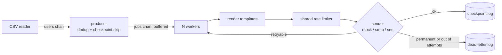

# emailblast

[](https://github.com/bryanwahyu/emailblast/actions/workflows/ci.yml)

A single-binary Go CLI that sends a personalised HTML email to every row of a CSV, through SMTP or Amazon SES, and can resume after a crash without starting over.

## Why

Sending one templated email to a few hundred thousand people sounds trivial until the process dies halfway through. Then you have to work out who already got it, you can't load the whole list into memory, and the provider will throttle you if you go faster than your quota. I wanted a tool where the CSV is streamed, the send rate is capped in one place, and a rerun picks up where the last one stopped.

By default nothing is sent: the backend is `mock`, which only logs. Real mail goes out only with `-backend smtp` or `-backend ses`.

## How it works



- `internal/source` streams the CSV in a goroutine. Columns `id` and `email` are required, every other column becomes a template field (`{{.first_name}}`).
- `internal/blast` owns the pipeline: one producer, a fixed pool of workers under an `errgroup`, one `rate.Limiter` shared by all workers.
- `internal/sender` has the backends. SES is behind the `ses` build tag so the default binary has no AWS dependency.
- `internal/checkpoint` is an append-only file of completed IDs plus an in-memory set.

## Design decisions

**A fixed worker pool with one shared limiter, not a goroutine per recipient.** Sending is I/O-bound, so workers mostly wait on the network; the pool size only has to cover `rate × latency`. The limiter is the single place where the provider quota is enforced. Trade-off: throughput is `min(rate, workers / latency)`, so you have to size `-workers` and `-rate` for the backend; more workers past that point just queue.

**Checkpoint is buffered and flushed every 2 seconds, so delivery is at-least-once.** Each successful send appends the ID to a `bufio.Writer`; a progress goroutine flushes it every 2s. On restart the file is loaded and those IDs are skipped. Writing with `fsync` per record would make the duplicate window smaller but would tie throughput to disk sync speed. I chose the 2s window: after a hard kill, up to ~2s worth of recipients can be sent twice. To let a downstream system dedup, the recipient ID is set as the `Message-ID` (SMTP) or as an `idkey` message tag (SES).

**Errors are classified at the backend, retried in the pipeline.** Backends wrap transient failures in `sender.ErrRetryable` (SMTP `RCPT` 4xx, SES throttling and server faults). The worker retries those with exponential backoff starting at 200ms, up to `-attempts`; everything else goes straight to the dead-letter file. One bad address never stops the run. Trade-off: the classification is only as good as each backend's mapping of error codes.

**SMTP connections are pooled.** A TLS handshake plus `AUTH` per message dominates the cost of a small send. The SMTP sender keeps a channel of open clients, issues `RSET` between messages, and drops a connection on error instead of returning it. Pool size defaults to `-workers`.

Smaller things: duplicate emails in the CSV (after trim + lowercase) are dropped within a run; `-unsub-url` / `-unsub-mailto` add `List-Unsubscribe` headers (one-click when a URL is given); templates use `html/template`, so merge fields are escaped.

## Running it

Go 1.25+.

```bash
# mock backend, sample CSV in the repo, logs every send
go run . -in users.csv -backend mock -workers 200 -rate 500 -verbose

# render and count against a real backend config, send nothing
go run -tags ses . -in users.csv -backend ses -from "News <news@example.com>" -dryrun -verbose
```

SMTP:

```bash
go run . -in users.csv -backend smtp -from "News <news@example.com>" \
  -smtp-host smtp.example.com -smtp-port 587 -smtp-user USER -smtp-pass PASS
```

SES uses the standard AWS credential chain (`AWS_REGION`, env vars, or a profile) and needs the build tag: `go build -tags ses -o emailblast .`

Every flag has an env var equivalent (`EMAIL_WORKERS`, `SMTP_HOST`, ...); see `.env.example`. A `.env` file is read if present, but variables already set in the environment win. `go run . -h` lists all flags.

Docker:

```bash
cp .env.example .env
mkdir -p data && cp users.csv data/
docker compose up --build
```

## Tests

```bash
go test -race ./...
go vet ./... && go vet -tags ses ./...
```

13 tests across `render` (HTML escaping, missing keys), `blast` (retry then DLQ, retry classification, limiter actually throttles, producer dedup), `checkpoint` (resume reload, flush without close) and `sender` (dry-run never calls the inner backend, `List-Unsubscribe` header). CI runs vet, both builds and the race tests on every push.

## Benchmark

This measures the pipeline, not email delivery: mock backend with 20ms simulated latency per send, no rate limit.

```bash
go build -o emailblast . && go build -o gencsv ./cmd/gencsv
./gencsv -n 1000000 -out users_1m.csv
/usr/bin/time -l ./emailblast -in users_1m.csv -workers 1000 -mock-delay 20ms -rate 0 -checkpoint cp.log
```

Two runs on the same laptop (Intel i5-1038NG7, 16 GB, macOS, Go 1.25.5), both 1,000,000 sent and 0 failed:

| Run | Elapsed | Rate | Peak RSS |
|---|---:|---:|---:|
| original, in [`bench/results/benchmark_raw.txt`](bench/results/benchmark_raw.txt) | 21.0s | 47,711/s | 259 MB |
| re-run while writing this README | 27.3s | 36,574/s | 278 MB |

Expect different numbers on other machines. With a real provider, the quota is the limit, not this.

## Limitations and what I'd do next

- **Checkpoint can be corrupted by `kill -9`.** If the process dies mid-write, the last line is half-written and the next run appends to it, so that ID is recorded wrong and would be sent again on a later resume. The fix is to truncate a trailing partial line in `checkpoint.Open`.
- Memory grows with the number of unique recipients, because the dedup set and the checkpoint set are both in memory. Fine for a few million rows, not for much more.
- Single node only. Spreading a run across machines would need a shared queue and a shared checkpoint store; none of that is built.
- Bounces and complaints are not handled. SES/SMTP feedback has to go into a suppression list separately.
- Malformed CSV rows are skipped silently, without being counted.
- The module path is `emailblast`, so `go install github.com/bryanwahyu/emailblast@latest` does not work yet.

## License

MIT
